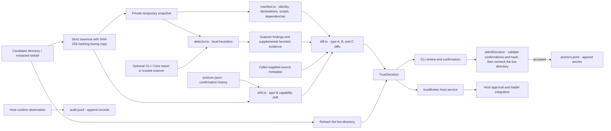
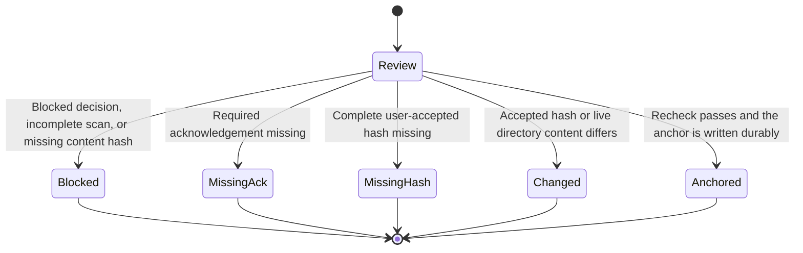

# Architecture

[简体中文](ARCHITECTURE.md)

## 1. Data flow



## 2. Module responsibilities

| Module | Responsibility | Key constraints |
|---|---|---|
| `src/core/manifest.ts` | Read plugin identity, permission declarations, install scripts, dependency sources, and the auto-update declaration | Reject entry points outside the candidate tree. Distinguish missing declarations from explicit `false` values |
| `src/core/external-scan.ts` | Consume a schema 2 report or run a trusted scanner the caller explicitly selects | The executable must use an absolute path outside the candidate tree and snapshot. Reports and stdout are capped at 8 MiB. Failure of an explicitly requested scan makes coverage incomplete |
| `src/core/heuristic.ts` | Check local heuristics for capabilities, composition overrides, Host dependencies, and remote-content indicators | Mark findings `heuristic: true`. Unreadable files and exceeded limits make coverage incomplete |
| `src/core/detector.ts` | Combine scanner findings, supplemental local heuristics, auto-update indicators, and coverage | Keep local evidence for capabilities an external report omits. Report the two sources separately |
| `src/core/diff.ts` | Build type A, B, and C diffs, assess declaration completeness and provenance, and compute the capability set | Only type A and B diffs can carry `new_capability: true`. Deduplicate evidence and limit the number of lines shown |
| `src/core/hash.ts` | Hash the candidate directory and optionally copy it into a snapshot | Admission mode covers the complete tree and rejects links and special files. Hash failures return `hash: null` |
| `src/core/anchor-store.ts` | Validate, read, and append `TrustAnchor` JSONL | Validate before writing and call `fsync` after writing. Report corrupt records on read |
| `src/core/drift.ts` | Compare current capabilities against previously confirmed anchors | A matching content hash can waive repeat confirmation for capabilities already covered by that anchor |
| `src/core/decision.ts` | Assemble status, recommended action, and required confirmations | Read candidate content without modifying it. Remove the private snapshot when evaluation ends |
| `src/core/policy.ts` | Parse policy files and resolve the storage directory | Report type errors. Include the effective policy in the decision |
| `src/admission/gate.ts` | Validate required acknowledgements, the complete user-accepted hash, and the live directory | Reject blocked decisions, incomplete scans, and missing or mismatched hashes. Append an anchor on success |
| `src/runtime/audit.ts` | Register Host listeners, read anchors, and record tool and context events | Observe waterfalls and return the downstream decision unchanged. Warn on log write failures and allow DSH dispatch to continue |
| `src/plugin/index.ts` | Register the `trustBroker` service and manage runtime resources | Host evaluation accepts a root and an abort signal and uses local heuristics. Unload cancels in-flight evaluations and closes the audit writer |
| `src/cli/*` | Provide review, confirmation, anchor listing, audit, diagnostic scans, JSON output, and exit codes | Supports injected I/O for end-to-end tests |

## 3. Decision pipeline (`evaluatePluginTrust`)

1. Resolve the storage directory, policy, and candidate root, then create a private temporary directory.
2. Traverse the candidate tree in strict mode. Read, hash, and copy each file to the snapshot from the same open file descriptor. Coverage includes the entire tree, including dependencies already present on disk.
3. Read the manifest and local heuristic evidence from the snapshot. CLI and Core callers can supply a schema 2 report explicitly or set `trust_check_bin` to a trusted scanner outside the candidate tree. The scanner gets a minimal environment for locating Node. Failures and timeouts make coverage incomplete.
4. Rehash the live directory. Unreadable files, links, special files, exceeded limits, or changes during the scan produce `unscannable` / `block_for_review`.
5. Read historical anchors for the plugin name, calculate capability drift, source discrepancies, and declaration completeness, then return a `TrustDecision`. Remove the snapshot when evaluation ends.

## 4. Admission state machine (`admitDecision`)



In interactive mode, the CLI collects acknowledgement phrases and confirmation of the full hash. In non-interactive mode, it reads explicit acknowledgement flags and `--accept-hash` from the caller. Anchor write failures surface as errors. The CLI appends the decision digest, required confirmations, and outcome to `decisions.jsonl`.

## 5. DSH Host bundle at runtime

`apply()` registers `trustBroker` and binds evaluation to the Host-configured anchor and log paths. The Host calls `evaluate({ root, signal })` to run local heuristics. On unload, the service rejects new evaluations, cancels and waits for evaluations in progress, and closes the audit writer. Calls already inside a waterfall can still receive the downstream decision.

| Event | Mode | Behavior |
|---|---|---|
| `tools/pre-execute` | waterfall | Record `tool_call`. Append `scope_exceeded` for capabilities beyond the anchor and return `next()` unchanged |
| `tools/post-execute` | waterfall | Record the result and context changes using the DSH post-execute decision, then return that decision unchanged |
| `system-prompt/assemble` | waterfall | Record `context_write(prompt_assembly)` when the assembled prompt digest changes and return the downstream assembly unchanged |
| `agent/inbox/inserted` | emit | Record `context_write(inbox_insert)` |
| `session/event` | emit | Record `context_write(history_compress)` for `compaction/*` |

## 6. Loader integration in DSH 0.2.x

The Host owns DSH 0.2.x installation and load approval. The `plugin-manager/*` events support observation. Enforcing admission before installation requires a Host integration. The Broker supplies an evaluation result, anchor records, and runtime observation. The DSH approval pipeline continues to make one-time decisions for tool permission requests.

### 6.1 CLI evaluation and anchoring

```bash
node bin/trust-broker.mjs review "$EXTRACTED" --json --non-interactive
node bin/trust-broker.mjs confirm "$EXTRACTED" --non-interactive --accept-hash "$APPROVED_CONTENT_HASH"
```

Add the `--acknowledge-*` flags required by the review. A review exit code of 0 means the current recommendation is to proceed. Code 2 means confirmation is required. Code 3 means the decision is blocked. When using external evidence, pass the same `--trust-check-report FILE` or trusted `--policy FILE` to both commands. Configure `trust_check_bin` as an absolute path in the policy. The operator who supplies that policy must trust the scanner and its dependencies separately.

### 6.2 Host load flow

The Host stages the candidate and its dependencies in a controlled directory, then calls `trustBroker.evaluate({ root, signal })`. It shows the user the permission differences and full content hash, obtains authorization through Host approval, and uses `admitDecision` to recheck the tree and record the anchor. The loader then binds the approved hash to the files actually used by `apply()`. Re-extraction, downloads, dependency installation, and install scripts can change what executes. The loader must recheck any such changes before activation.

### 6.3 Runtime auditing

Once the Host bundle activates, it registers tool and context observers. The audit log records the observed events. Host approval provides installation authorization.

## 7. Storage layout

```text
<store_dir>/                    # Default: $DSH_HOME/trust-broker or ~/.dsh/trust-broker
├── anchors.jsonl               # Append-only TrustAnchor records, one per confirmation
├── decisions.jsonl             # CLI decisions, outcomes, confirmations, diff IDs, and decision digests
└── audit.jsonl                 # Runtime events written by the Host bundle
```

All three files are schema-versioned, append-only JSONL. Readers report and skip corrupt lines, including a partial final line after a crash. Production deployments can use an external log rotation policy. See the [audit schema](AUDIT-SCHEMA.en.md).

## 8. Test strategy

- **Unit and integration tests.** `node --test` runs without a test framework dependency. Fixtures are plugin directories covering complete, missing, and insufficient declarations, install scripts, auto-update, and invalid JSON.
- **End-to-end tests.** Inject in-memory CLI I/O to exercise review, confirmation, anchor writing, listing, and audit verification.
- **Host plugin tests.** `createFakeContext()` verifies all five listener registrations, `provide('trustBroker')`, `evaluate`, `record`, the waterfall return contract, and disposal.
- **Security paths.** Cover strict hashing, link rejection, live-directory rechecks, log appends, external scanner failures, scanner environment and cleanup, and capability drift.
- **Evidence separation.** Types and tests distinguish heuristic findings from external scanner findings.

```bash
npm run typecheck   # Strict TypeScript checking
npm test            # Full test suite
npm run build       # dist/ (DSH bundle runtime artifacts)
```

## 9. Extension points

| Extension point | Location | Notes |
|---|---|---|
| Capability categories and high-privilege rules | `src/core/catalog.ts` | Update the documentation and tests when changing this rule table |
| External scanner adapter | `src/core/external-scan.ts` | Supports `dsh-trust-check` schema 2. Other adapters can normalize findings to `CapabilityFact` |
| Policy | `PolicyConfig` / policy file | Relaxed settings appear in the decision's effective `policy` |
| Tool attribution | `RuntimeAuditConfig.tool_owners` / `setToolOwner` | Map registered tools to a `plugin_id` so `scope_exceeded` can identify the owning plugin |
| Confirmation UI | `src/cli/prompt.ts` / Host UI | The CLI is the reference implementation. A GUI can share the policy through `--json` and `admitDecision` |

## 10. Compatibility and versions

- Decisions, audit events, and anchors each use `schema_version = 1`.
- The `dsh-plugin-content-v2` hash domain changes the admission hash format. Historical anchors remain readable. A v1 hash cannot match a v2 candidate, so review the current content again.
- Append new audit event types and preserve existing fields. Increment `schema_version` for breaking changes.
- The ESM runtime supports Node `^22.19 || >=24` with zero runtime dependencies. Development tests run `.ts` files directly with Node 24 type stripping.

See the [security model](SECURITY-MODEL.en.md) for the threat model and remaining loader responsibilities.
