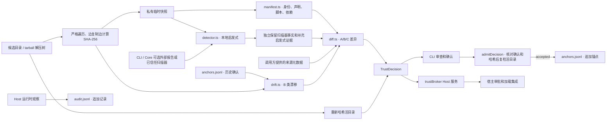
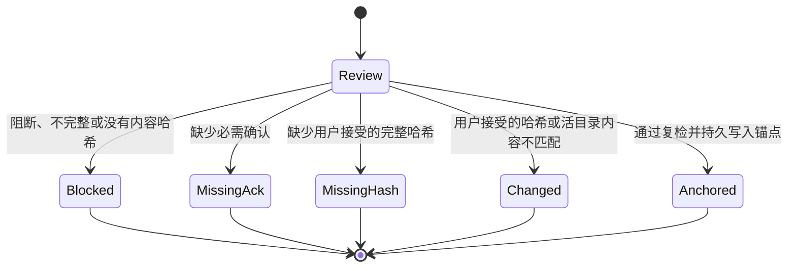

# 架构（Architecture）

[English edition](ARCHITECTURE.en.md)

## 1. 数据流总览



## 2. 模块职责

| 模块 | 职责 | 关键约束 |
|---|---|---|
| `src/core/manifest.ts` | 读取插件身份、权限声明、安装脚本、依赖来源和 autoUpdate 声明 | 拒绝越界入口。缺失和显式 false 分开处理 |
| `src/core/external-scan.ts` | 消费 schema 2 报告或运行调用方显式指定的可信扫描器 | 可执行文件必须使用候选树和快照外的绝对路径。报告和 stdout 上限为 8 MiB。显式扫描失败使覆盖不完整 |
| `src/core/heuristic.ts` | 本地启发式检查能力、bundle patch 组合变更、Host 依赖和远程内容指示器 | 标记 `heuristic: true`。只解析 manifest 声明的 patch 文件（字符串或数组），并按 DSH 语义结构解析：`insert` 低权限，任何非 insert 的 id-targeted 变更为高权限；不可读、缺文件、无法解析或超限使覆盖不完整 |
| `src/core/detector.ts` | 汇总扫描事实、补充的本地启发式证据、auto_update 与扫描覆盖 | 外部报告遗漏的能力保留本地证据。两个来源分别输出 |
| `src/core/diff.ts` | A/B/C 差异、声明完整性、来源可信度和能力集 | 只有 A/B 可标记 `new_capability: true`。证据去重并限制展示行数 |
| `src/core/hash.ts` | 哈希候选目录并可选地复制到快照 | 准入模式覆盖完整树，拒绝链接和特殊文件。失败返回 `hash: null` |
| `src/core/anchor-store.ts` | 校验、读取及追加 `TrustAnchor` JSONL | 写前校验及 fsync。读取时报告损坏行 |
| `src/core/drift.ts` | 比对当前能力与已确认锚点 | 相同内容且锚点覆盖本次检出能力时可跳过重复确认 |
| `src/core/decision.ts` | 组装状态、建议动作与确认队列 | 候选内容只读。私有快照在评估退出时删除 |
| `src/core/policy.ts` | 解析策略文件与存储目录 | 错误类型报错。生效策略写入决策 |
| `src/admission/gate.ts` | 校验必需确认、用户接受的完整哈希和活目录内容 | 阻断结果、扫描不完整、哈希缺失或不匹配均拒绝准入。成功时追加锚点 |
| `src/runtime/audit.ts` | 注册 Host 监听、读取锚点并记录工具与上下文事件 | 观察瀑布流并原样返回下游决策。写日志失败时发出警告，派发继续 |
| `src/plugin/index.ts` | 注册 `trustBroker` 服务并管理运行期资源 | Host 评估只接收根目录和取消信号，使用内置启发式。卸载时取消在途评估并关闭审计 |
| `src/cli/*` | 终端审查/确认/锚点/审计/调试扫描；JSON 输出；退出码契约 | 可注入 IO，便于端到端测试 |

## 3. 决策组装流水线（`evaluatePluginTrust`）

1. 解析存储目录、策略及候选根目录，创建私有临时目录。
2. 对候选树严格遍历，从同一个文件描述符读取、计算哈希和写入快照。默认覆盖完整树，包括已经物化的依赖。
3. 从快照读取 manifest 和本地启发式证据。CLI / Core 可显式提供 schema 2 报告，或使用策略中的 `trust_check_bin` 运行候选树外的可信扫描器。扫描进程只得到定位 Node 的最小环境，失败或超时标记覆盖不完整。
4. 再次哈希活目录。文件不可读、存在链接或特殊文件、超过上限、扫描期间发生变化时，返回 `unscannable` / `block_for_review`。
5. 读取同名插件的历史锚点，计算能力漂移、来源差异和声明完整性，生成 `TrustDecision`。锚点日志不可读或任一行校验失败时返回 `unscannable` / `block_for_review`，不静默丢失更新基线。评估结束时清理快照。

## 4. 准入状态机（`admitDecision`）



CLI 在交互模式收集确认口令与完整哈希确认，在非交互模式读取调用方明确提供的确认参数和 `--accept-hash`。锚点写入失败向调用方报告错误。CLI 将决策摘要、确认项和处理结果追加到 `decisions.jsonl`。

## 5. DSH Host bundle 运行时

`apply()` 注册 `trustBroker`，将评估固定在 Host 配置的锚点和日志目录。宿主调用 `evaluate({ root, signal })` 走内置启发式路径。卸载时拒绝新的评估、取消并等待在途评估，关闭审计写入。已进入瀑布流的调用可继续得到下游决策。

| 事件 | 模式 | 行为 |
|---|---|---|
| `tools/pre-execute` | waterfall | 记录 `tool_call`。超出已锚定能力时追加 `scope_exceeded`，原样返回 `next()` |
| `tools/post-execute` | waterfall | 依据 DSH post 决策记录结果和上下文变化，原样返回下游决策 |
| `system-prompt/assemble` | waterfall | 装配摘要变化时记录 `context_write(prompt_assembly)`，原样返回下游装配 |
| `agent/inbox/inserted` | emit | 记录 `context_write(inbox_insert)` |
| `session/event` | emit | 记录 `compaction/*` 对应的 `context_write(history_compress)` |

## 6. 加载器接入（当前 DSH 版本）

DSH 0.2.x 的安装和加载审批由宿主负责。当前 `plugin-manager/*` 事件可用于观察，安装前强制接入需要由宿主实现。Broker 提供评估结果、锚定和运行时观察。工具的权限请求继续由 DSH 审批流水线作一次性决策。

### 6.1 CLI 评估与锚定

```bash
node bin/trust-broker.mjs review "$EXTRACTED" --json --non-interactive
node bin/trust-broker.mjs confirm "$EXTRACTED" --non-interactive --accept-hash "$APPROVED_CONTENT_HASH"
```

调用方根据审查结果附加所需 `--acknowledge-*` 参数。审查退出码 0 表示当前建议可继续，2 表示需要确认，3 表示阻断。需要外部证据时在审查和确认两次命令中使用同一份 `--trust-check-report FILE` 或同一个可信 `--policy FILE`。策略中以绝对路径配置 `trust_check_bin`。扫描器代码及其依赖由配置该策略的操作者另行信任。

### 6.2 宿主加载流程

宿主将候选及其依赖物化到受控目录，再调用 `trustBroker.evaluate({ root, signal })`。根据决策向用户展示具体权限差异及完整内容哈希，通过宿主审批获取授权，并使用 `admitDecision` 复检及记录锚点。加载器随后绑定已批准的内容哈希和实际交给 `apply()` 的文件。重新解包、下载、安装依赖或执行安装脚本可能改变执行内容，必须由加载器在交付前再次校验。

### 6.3 运行时审计

Host bundle 激活后注册工具和上下文观察。审计日志记录观察到的事件，安装授权由宿主审批提供。

## 7. 存储布局

```text
<store_dir>/                    # 默认 $DSH_HOME/trust-broker 或 ~/.dsh/trust-broker
├── anchors.jsonl               # TrustAnchor 只追加（每次确认一行）
├── decisions.jsonl             # CLI 决策审计（接受/拒绝、确认项、diff ids、decision digest）
└── audit.jsonl                 # 运行时审计事件（Host bundle 写入）
```

三个文件都是 schema-versioned 的只追加 JSONL；存储解析端可报告并跳过 torn last line 与损坏行，便于崩溃恢复和人工检查。准入评估对锚点日志采用更严格的不变量：任何读取、解析或锚点校验错误都会阻断，防止更新基线被静默削弱。v1 不做自动轮转，生产部署可配合外部日志轮转。

## 8. 测试策略

- **单元 + 集成**：`node --test`，无测试框架依赖；fixtures 为真实插件目录（声明完整/未声明/声明不足/安装脚本/auto_update/坏 JSON）。
- **端到端**：CLI 以内存 IO 注入跑完整流程（审查 → 确认 → 锚点 → 列表 → 审计校验）。
- **Host 插件**：`createFakeContext()` 验证 5 个监听注册、`provide('trustBroker')`、`evaluate`、`record`、waterfall 返回值契约与 dispose。
- **安全关键路径**：覆盖严格哈希、链接拒绝、活目录复检、日志追加、外部扫描失败、扫描器环境与资源清理以及能力漂移。
- **分区间隔离**：启发式事实与可复核事实在类型与测试两层都断言不混放。

```bash
npm run typecheck   # strict TS
npm test            # 全量测试
npm run build       # dist/（DSH bundle 运行时产物）
```

## 9. 扩展点

| 扩展点 | 位置 | 说明 |
|---|---|---|
| 能力类别 / 高权限判定 | `src/core/catalog.ts` | 规则表；改动需同步文档与测试 |
| 外部扫描器适配 | `src/core/external-scan.ts` | 目前支持 `dsh-trust-check` schema 2；可加其他扫描器适配器，统一映射到 `CapabilityFact` |
| 策略 | `PolicyConfig` / policy file | 默认值不可静默放宽：放宽项写入决策 `policy` 字段 |
| 工具归属 | `RuntimeAuditConfig.tool_owners` / `setToolOwner` | 将插件注册的工具名映射到 `plugin_id`，启用真实 `scope_exceeded` |
| 确认交互 | `src/cli/prompt.ts` / 宿主 UI | CLI 为参考实现；GUI 可用 `--json` + `admitDecision` 复用同一策略 |

## 10. 兼容性与版本

- `TrustDecision.schema_version = 1`、审计事件 `schema_version = 1`、锚点 `schema_version = 1`。
- `dsh-plugin-content-v2` 哈希域更新了准入哈希格式。旧锚点仍可读取，旧哈希无法匹配 v2 候选，需要重新复核当前内容。
- 新增审计事件类型时只在末尾追加并保持旧字段不变；破坏性变更提升 `schema_version`。
- Node：运行时 `^22.19 || >=24`（ESM，零运行时依赖）；开发测试在 Node 24 上直接运行 `.ts`（type stripping）。
